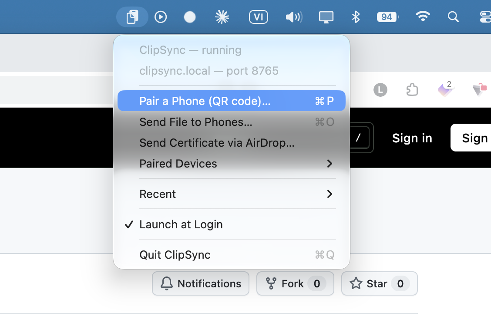
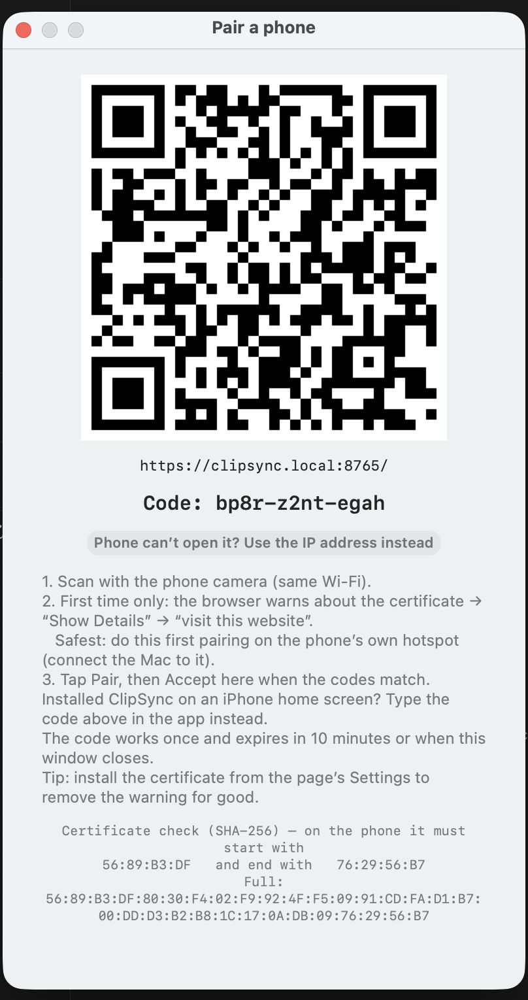
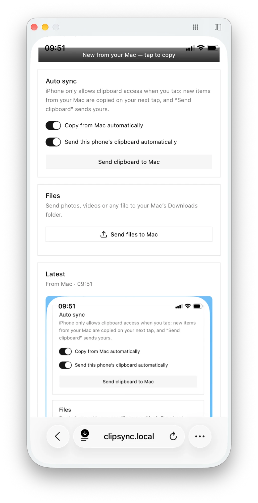
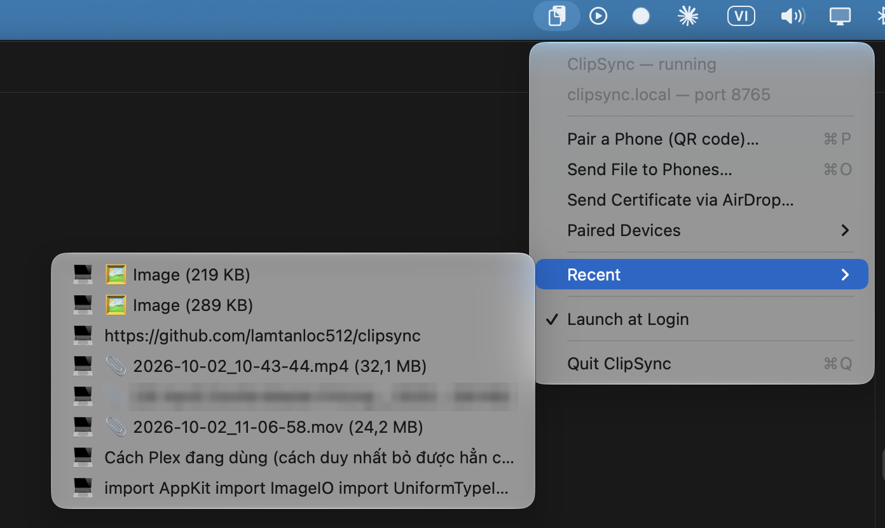

# ClipSync

**English** · [Tiếng Việt](README.vi.md)

Copy on your Mac, paste on your phone — and the other way round. ClipSync syncs your clipboard and sends files between your Mac and your Android phone or iPhone over your own Wi‑Fi, like KDE Connect. Nothing to install from an app store, no account, no cloud.

- **Clipboard sync both ways**, automatically while ClipSync is open on the phone
- **Files and videos of any size**, phone → Mac's Downloads, or Mac → phone
- **Share menu on Android:** send photos, videos and links from any app
- **Notifications** for Mac copies even while ClipSync is closed on the phone
- **Private and secure:** stays on your network, encrypted, pairing needs the code on your Mac's screen

Works with **macOS 11+** and **Android (Chrome)** or **iPhone/iPad (iOS 16.4+)** on the same Wi‑Fi.

## 1. Install on your Mac

1. Download **ClipSync-macOS.zip** from the [latest release](https://github.com/lamtanloc512/clipsync/releases/latest) and unzip it.
2. Drag **ClipSync** into **Applications** and open it.
3. When macOS asks to allow incoming network connections, click **Allow**.

ClipSync lives in the menu bar (clipboard icon) and shows a QR code the first time.

<p align="center"></p>

## 2. Connect your phone



1. Scan the QR code with your phone's camera. (Later: menu bar icon → **Pair a Phone**.)
2. The browser warns that the connection isn't private — expected the first time, as your Mac uses its own certificate. Continue anyway (Android: **Advanced → Proceed**; iPhone: **Show Details → visit this website**).
3. The phone pairs by itself, and your Mac shows a notification.
4. Tap **Install** (Android) or **Share → Add to Home Screen** (iPhone) to get ClipSync as an app.

That's it. Keep ClipSync open on the phone and your clipboards stay in sync.

<details>
<summary><b>Recommended: trust your Mac's certificate</b> (removes the warning, needed to install the app on Android, and needed on iPhone if pairing can't reach your Mac)</summary>

In ClipSync on the phone, open **⚙ Settings → Trust your Mac's certificate**, then:

- **Android:** download the certificate → phone **Settings → Security → Encryption & credentials → Install a certificate → CA certificate**.
- **iPhone:** on the Mac choose **Send Certificate via AirDrop…** (or download the profile) → **Settings → General → VPN & Device Management** → install → **Settings → General → About → Certificate Trust Settings** → turn on ClipSync.

On iPhone, if ClipSync opens but pairing says it can't reach your Mac (or shows **Load failed**) and the Mac and phone are on the same Wi‑Fi, no warning appears to continue past. Trust the certificate as above: start from the Mac, since the phone can't reach ClipSync yet.

The certificate only works for devices on your local network; it can't be used for real websites. For the most careful setup, do this on your phone's own hotspot and check that the fingerprint matches the one under the QR code on your Mac.
</details>

<details>
<summary><b>iPhone home‑screen app</b></summary>

On iPhone, the installed app doesn't share Safari's data, so pair it from inside the app: open ClipSync from the Home Screen and type the **code** shown under the QR code on your Mac.
</details>

## 3. Use it

<p align="center"></p>

| | How |
|---|---|
| Mac → phone | Copy on the Mac. Android copies it right away; on iPhone, tap anywhere in ClipSync. |
| Phone → Mac | Copy on the phone. Android sends it automatically after you tap **Allow** once; on iPhone, tap **Send clipboard to Mac**. |
| Files phone → Mac | **Send files to Mac** in ClipSync, or **Share → ClipSync** on Android. They land in Downloads and on the Mac clipboard. |
| Files Mac → phone | Copy a file in Finder (⌘C) or use **Send File to Phones…** in the menu, then tap **Download** on the phone. |
| Unpair | Menu bar → **Paired Devices** → choose a phone → **Unpair**. |

Web pages can't run in the background, so the phone syncs while ClipSync is open and catches up as soon as you open it. To hear about Mac copies while it's closed, turn on **Notify me when ClipSync is closed**: each copy on the Mac shows a notification — tap it and ClipSync opens and copies it. (Needs Internet on both devices; on Android the certificate must be trusted, on iPhone use the Home Screen app.) To send from Android without opening ClipSync, tap **Share** in the clipboard popup that appears after copying, then **ClipSync**.

**Recent** in the menu keeps the last 20 items — text, images and files from the Mac or your phones (📱/💻 shows where they came from). Click one to copy it again.

<p align="center"></p>

## Troubleshooting

| Problem | Fix |
|---|---|
| The QR link doesn't open | Same Wi‑Fi on both? Click **Use the IP address instead** under the QR code (some Android phones can't open `.local` addresses). |
| Pairing through **iPhone Mirroring** | The camera doesn't work while mirroring: open ClipSync in Safari on the iPhone, then copy the **code** from the Mac's pairing window and paste it in. |
| "Mac not reachable" | Is ClipSync running and the Mac awake? Guest/public Wi‑Fi often blocks devices from talking to each other — use your phone's hotspot. |
| Nothing is sent from the phone | Tap **Allow** under Auto sync (Android). On iPhone use **Send clipboard to Mac**. |
| No **Install** button on Android | Trust the certificate first (see above), then reload. |
| Passwords don't sync | On purpose: copies from password managers are never shared. |

## Privacy & security

Everything stays on your network — ClipSync has no servers and no analytics. The optional notifications travel through Google's or Apple's push service, end-to-end encrypted and, by default, without any clipboard content. Connections are encrypted (HTTPS), pairing needs the one-time QR code from your Mac's screen, your Mac shows a notification for each new phone, and each phone can be unpaired at any time. A paired phone can read what you copy and change your Mac's clipboard, so only pair your own devices. Details: [SECURITY.md](SECURITY.md).

## For developers

- [CONTRIBUTING.md](CONTRIBUTING.md): building from source, architecture, HTTP API, iOS Shortcuts / Tasker automation, releases
- [Code of Conduct](CODE_OF_CONDUCT.md) · [Security policy](SECURITY.md)

```bash
git clone https://github.com/lamtanloc512/clipsync.git && cd clipsync && ./build-app.sh --install
```

ClipSync is free software under the [GNU GPL v3.0](LICENSE).
