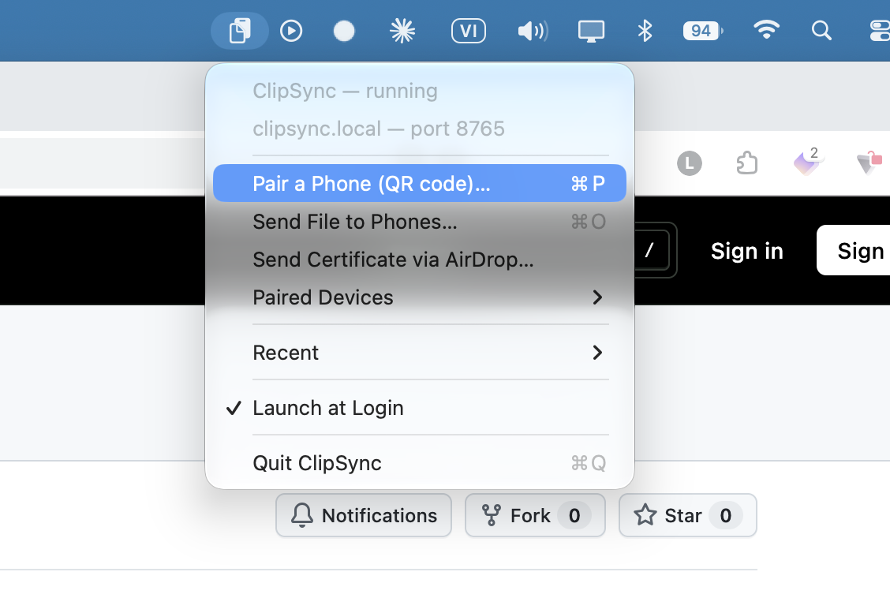
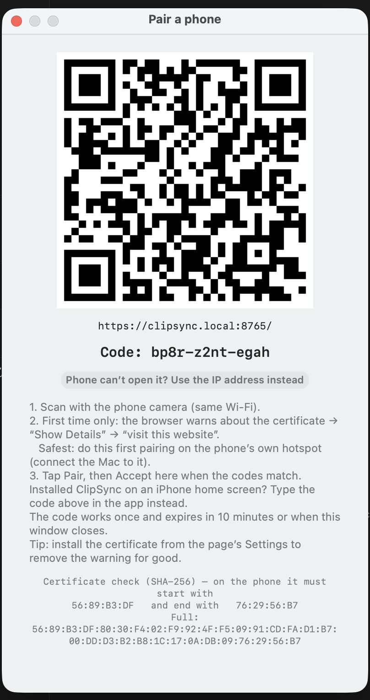
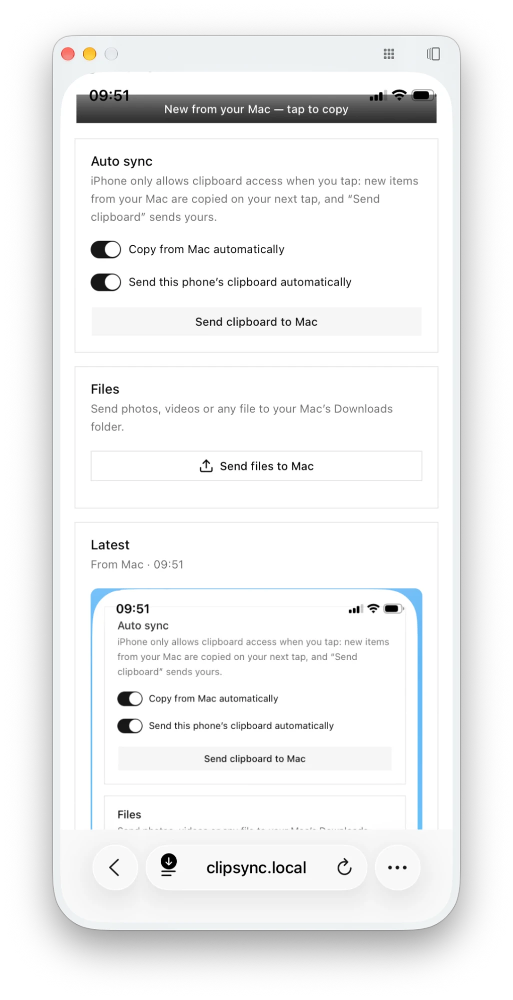
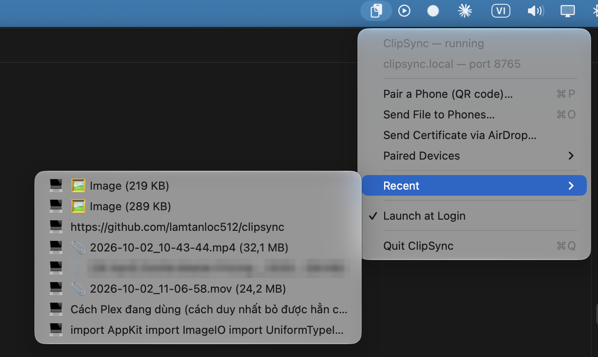

# ClipSync

[English](README.md) · **Tiếng Việt**

Copy trên Mac, dán trên điện thoại, và ngược lại. ClipSync đồng bộ clipboard và gửi file giữa Mac với điện thoại Android hoặc iPhone qua chính Wi‑Fi nhà bạn, giống KDE Connect. Không cần cài app từ store, không tài khoản, không cloud.

- **Đồng bộ clipboard hai chiều**, tự động khi ClipSync đang mở trên điện thoại
- **Gửi file và video dung lượng bao nhiêu cũng được**: điện thoại → thư mục Downloads của Mac, hoặc Mac → điện thoại
- **Menu Chia sẻ trên Android:** gửi ảnh, video, link từ bất kỳ app nào
- **Thông báo** khi Mac copy, kể cả lúc ClipSync đang đóng trên điện thoại
- **Riêng tư và an toàn:** chỉ đi trong mạng nhà bạn, có mã hoá, pair phải được xác nhận trên Mac

Chạy trên **macOS 11+** và **Android (Chrome)** hoặc **iPhone/iPad (iOS 16.4+)**, dùng chung một Wi‑Fi.

## 1. Cài trên Mac

1. Tải **ClipSync-macOS.zip** ở [bản phát hành mới nhất](https://github.com/lamtanloc512/clipsync/releases/latest) và giải nén.
2. Kéo **ClipSync** vào **Applications** rồi mở.
3. Khi macOS hỏi có cho phép kết nối mạng đến, bấm **Allow**.

ClipSync nằm trên thanh menu (biểu tượng clipboard) và hiện mã QR ở lần mở đầu tiên.

<p align="center"></p>

## 2. Kết nối điện thoại



1. Quét mã QR bằng camera điện thoại. (Lần sau: biểu tượng trên thanh menu → **Pair a Phone**.)
2. Trình duyệt báo kết nối không riêng tư. Điều này là bình thường ở lần đầu, vì Mac dùng chứng chỉ riêng. Cứ tiếp tục (Android: **Advanced → Proceed**; iPhone: **Show Details → visit this website**).
3. Bấm **Pair**, kiểm tra mã 4 số trùng với mã trên Mac, rồi bấm **Accept** trên Mac.
4. Bấm **Install** (Android) hoặc **Share → Add to Home Screen** (iPhone) để có ClipSync như một app.

Xong. Giữ ClipSync mở trên điện thoại là clipboard luôn được đồng bộ.

<details>
<summary><b>Nên làm: tin cậy chứng chỉ của Mac</b> (hết cảnh báo, và bắt buộc để cài app trên Android)</summary>

Trong ClipSync trên điện thoại, mở **⚙ Settings → Trust your Mac's certificate**, rồi:

- **Android:** tải chứng chỉ → **Cài đặt → Bảo mật → Mã hoá và thông tin xác thực → Cài đặt chứng chỉ → Chứng chỉ CA**.
- **iPhone:** trên Mac chọn **Send Certificate via AirDrop…** (hoặc tải profile) → **Cài đặt → Cài đặt chung → Quản lý VPN & thiết bị** → cài đặt → **Cài đặt → Cài đặt chung → Giới thiệu → Cài đặt tin cậy chứng nhận** → bật ClipSync.

Chứng chỉ này chỉ dùng được cho thiết bị trong mạng nội bộ, không thể dùng cho website thật. Muốn cẩn thận nhất, hãy làm bước này khi đang dùng hotspot của chính điện thoại, và so fingerprint với dòng hiện dưới mã QR trên Mac.
</details>

<details>
<summary><b>App trên màn hình chính iPhone</b></summary>

Trên iPhone, app đã cài không dùng chung dữ liệu với Safari, nên hãy pair ngay trong app: mở ClipSync từ màn hình chính và gõ **mã (code)** hiện dưới mã QR trên Mac.
</details>

## 3. Sử dụng

<p align="center"></p>

| | Cách làm |
|---|---|
| Mac → điện thoại | Copy trên Mac. Android chép vào ngay; trên iPhone, chạm vào bất kỳ đâu trong ClipSync. |
| Điện thoại → Mac | Copy trên điện thoại. Android tự gửi sau khi bạn bấm **Allow** một lần; trên iPhone, bấm **Send clipboard to Mac**. |
| File điện thoại → Mac | **Send files to Mac** trong ClipSync, hoặc **Chia sẻ → ClipSync** trên Android. File vào Downloads và vào clipboard Mac. |
| File Mac → điện thoại | Copy file trong Finder (⌘C) hoặc dùng **Send File to Phones…** trên menu, rồi bấm **Download** trên điện thoại. |
| Gỡ pair | Thanh menu → **Paired Devices** → chọn điện thoại → **Unpair**. |

Trang web không chạy nền được, nên điện thoại đồng bộ khi ClipSync đang mở và tự bắt kịp ngay khi bạn mở lại. Muốn được báo khi Mac copy lúc ClipSync đang đóng, hãy bật **Notify me when ClipSync is closed**: mỗi lần copy trên Mac, điện thoại hiện thông báo, chạm vào là ClipSync mở ra và chép luôn. (Cần Internet trên cả hai máy; Android phải tin cậy chứng chỉ, iPhone dùng app trên màn hình chính.) Muốn gửi từ Android mà không mở ClipSync: sau khi copy, bấm **Chia sẻ** trên ô clipboard hiện ra, rồi chọn **ClipSync**.

Mục **Recent** trên menu giữ 20 nội dung gần nhất: chữ, ảnh và file từ Mac hoặc điện thoại (📱/💻 cho biết nguồn). Bấm vào để copy lại.

<p align="center"></p>

## Xử lý sự cố

| Vấn đề | Cách xử lý |
|---|---|
| Link trong QR không mở được | Hai máy cùng Wi‑Fi chưa? Bấm **Use the IP address instead** dưới mã QR (một số máy Android không mở được địa chỉ `.local`). |
| Pair qua **iPhone Mirroring** | Camera không dùng được khi đang mirroring: mở ClipSync trong Safari trên iPhone, rồi copy **mã (code)** trong cửa sổ pair trên Mac và dán vào. |
| "Mac not reachable" | ClipSync có đang chạy, Mac có đang ngủ không? Wi‑Fi công cộng hoặc Wi‑Fi khách thường chặn các thiết bị nói chuyện với nhau, khi đó hãy dùng hotspot của điện thoại. |
| Điện thoại không tự gửi | Bấm **Allow** trong Auto sync (Android). Trên iPhone dùng **Send clipboard to Mac**. |
| Không thấy nút **Install** trên Android | Tin cậy chứng chỉ trước (xem phần trên), rồi tải lại trang. |
| Mật khẩu không được đồng bộ | Đây là chủ ý: nội dung copy từ trình quản lý mật khẩu không bao giờ được chia sẻ. |

## Riêng tư và bảo mật

Mọi thứ chỉ đi trong mạng của bạn, ClipSync không có server và không thu thập dữ liệu. Thông báo (tuỳ chọn) đi qua máy chủ đẩy của Google hoặc Apple, được mã hoá đầu-cuối và mặc định không chứa nội dung clipboard. Kết nối được mã hoá (HTTPS). Muốn pair phải có mã QR trên màn hình Mac và bạn phải bấm **Accept**; mỗi điện thoại có thể unpair bất cứ lúc nào. Điện thoại đã pair đọc được những gì bạn copy và thay đổi được clipboard của Mac, nên chỉ pair thiết bị của chính bạn. Chi tiết: [SECURITY.md](SECURITY.md) (tiếng Anh).

## Dành cho lập trình viên

- [CONTRIBUTING.md](CONTRIBUTING.md) (tiếng Anh): build từ mã nguồn, kiến trúc, HTTP API, tự động hoá bằng iOS Shortcuts / Tasker, quy trình phát hành
- [Quy tắc ứng xử](CODE_OF_CONDUCT.md) · [Chính sách bảo mật](SECURITY.md)

```bash
git clone https://github.com/lamtanloc512/clipsync.git && cd clipsync && ./build-app.sh --install
```

ClipSync là phần mềm tự do theo giấy phép [GNU GPL v3.0](LICENSE).
